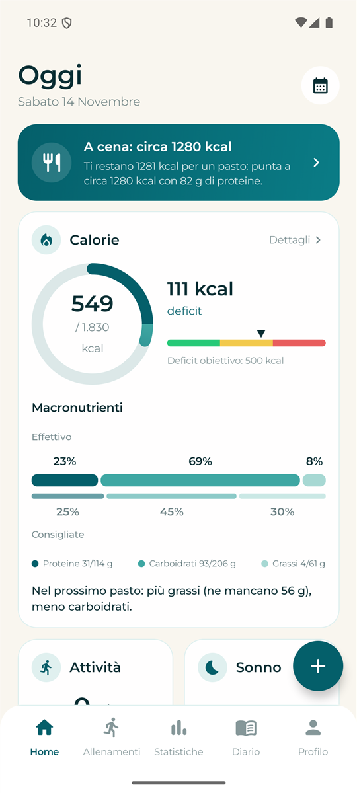
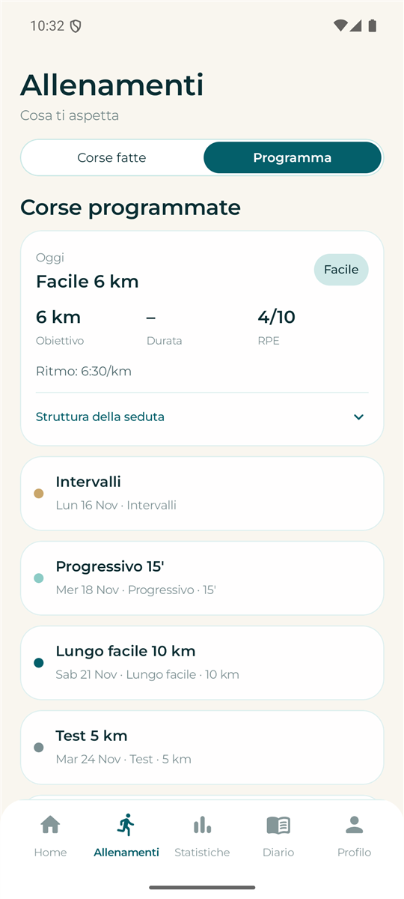
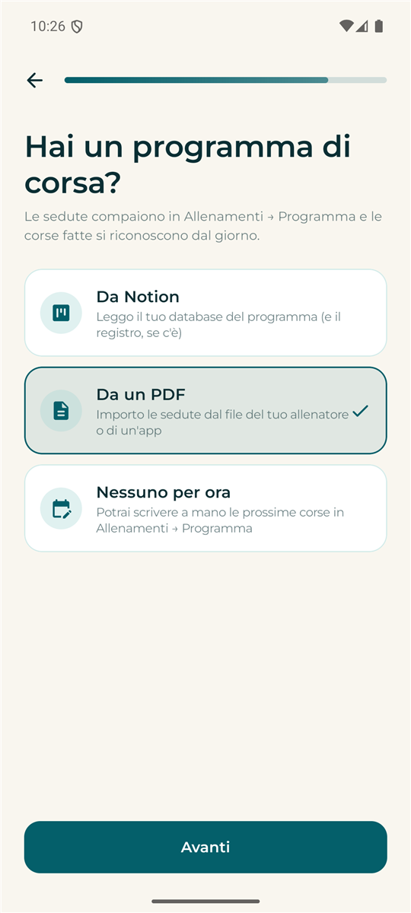
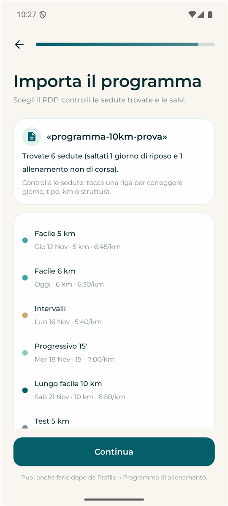

# UNICUM

**Your health. Unified.** An Android app that brings nutrition, activity, sleep, recovery and your running plan into one calm screen.

*🇮🇹 [Versione italiana più sotto](#italiano)*

<p>
  
  
  
  
</p>

Your ring tracks your sleep, your watch tracks your runs, a food app tracks your meals, and your coach's plan lives in a PDF or in Notion. UNICUM reads all of them and shows **one day, one picture**: what you ate, what you burned, how you slept, how recovered you are, and what today's run should be.

> The app is in Italian for now. English translations are welcome. See [Contributing](#contributing).

## Features

- **Nutrition**: daily calorie goal from your BMR (Mifflin-St Jeor) and activity level, macros, ~300 built-in foods, barcode scanner and online search via Open Food Facts. Meals are written back to Health Connect.
- **Deficit, honestly**: your resting burn accrues through the day instead of being subtracted all at once in the morning, so the balance is real at any hour.
- **Runs**: every run from Health Connect with splits, heart-rate zones, pace, cadence, elevation and route map. Duplicates from different apps are merged. Intervals can be split from the plan's structure.
- **Training plan** from three sources:
  - **Notion**: reads your plan database and, optionally, your run log. See [`docs/notion/`](docs/notion/) for the exact schema and importable CSV examples.
  - **PDF**: imports sessions from your coach's or app's PDF (dates or "week + day", type, km, minutes, pace, RPE), with an editable preview.
  - **By hand**: add future sessions yourself.

  A planned session is marked done automatically when a run is recorded on the same day.
- **Recovery**: an estimate based on nightly HRV, sleep and measured training load. It detects by itself when your HRV changes scale (for example, a new device) and ignores the old values.
- **Goals and estimates**: 5/7/10 km time estimates from heart rate and your best efforts (Riegel), short- and long-term running goals with projections.
- **Shoes**: mileage per pair, with a default pair assigned automatically.
- **Widgets, reminders, light and dark theme, local backup and restore.**

## Privacy

There is no account and no server. Your data stays on your phone, in a local database and in Health Connect. The app only talks to:

- **Health Connect**, on the device: read access, plus writing your meals;
- **Notion API**, only if you connect it, with a read-only integration token you create;
- **Open Food Facts**, for food search and barcodes;
- **OpenStreetMap tiles**, for route maps.

## Install

1. Download the latest APK from [Releases](../../releases).
2. Install [Health Connect](https://play.google.com/store/apps/details?id=com.google.android.apps.healthdata). It is built into Android 14 and later.
3. Open UNICUM, answer a few questions, then connect Health Connect from **Profilo**.

Your watch or ring app (Samsung Health, Garmin via Health Sync, Fitbit, Oura, Ultrahuman, …) must share its data with Health Connect.

Requires Android 8.0 (API 26) or later.

## Build

```bash
git clone <this repo>
cd unicum/codice
./gradlew testDebugUnitTest assembleDebug
# APK: app/build/outputs/apk/debug/app-debug.apk
```

Requirements: JDK 17+ (the one bundled with Android Studio works) and the Android SDK.

**Optional personal defaults.** Copy `codice/personal.properties.example` to `codice/personal.properties` (git-ignored) to bake your own defaults into your build: the date from which your HRV is comparable, your Notion database IDs and a running goal. Without the file everything is detected or chosen in the app.

**Signed release.** Copy `codice/keystore.properties.example` to `codice/keystore.properties` (git-ignored), point it to your keystore, then run `./gradlew assembleRelease`.

## Tech

Kotlin · Jetpack Compose (Material 3) · Room · kotlinx.serialization · Health Connect · CameraX + ML Kit (barcodes) · PdfBox-Android. No DI framework and no ViewModels: small state objects observed by Compose. The pure logic (deficit, PDF parsing, HRV shift detection, recovery, run analysis, goals) is covered by unit tests.

```
codice/app/src/main/java/io/github/peol13/unicum/
├── data/        models, Room, Health Connect, Notion, PDF parser, analysis (pure logic + tests)
├── ui/screens/  Home, Runs, Stats, Diary, Profile, onboarding…
├── ui/components, ui/sections, ui/theme
└── widget/      home-screen widgets
```

## Contributing

Issues and pull requests are welcome, especially:

- English translation (move strings to `strings.xml`);
- more PDF plan formats (open an issue and attach an anonymised example);
- testing with other watches and rings via Health Connect.

Please read [CONTRIBUTING.md](CONTRIBUTING.md) first: it explains how contributions are licensed.

## License

UNICUM is free software, released under the [GNU General Public License v3.0 or later](LICENSE), with an additional permission for Google ML Kit (barcode scanning). You can use, study, share and modify it. If you distribute a modified version, you must release its source code under the same license.

The name **UNICUM** and its logo are not covered by the license. A modified version must use a different name and icon. See [NOTICE.md](NOTICE.md) for details and third-party licenses.

## Credits

- Font: [Montserrat](https://fonts.google.com/specimen/Montserrat), SIL Open Font License 1.1.
- [PdfBox-Android](https://github.com/TomRoush/PdfBox-Android), Apache License 2.0.
- Food data: [Open Food Facts](https://world.openfoodfacts.org), ODbL.
- Maps: © [OpenStreetMap](https://www.openstreetmap.org/copyright) contributors.
- Barcode scanning: Google ML Kit.
- Material Symbols (Rounded), Apache License 2.0.

---

<a name="italiano"></a>
## 🇮🇹 Italiano

**UNICUM** riunisce in una sola schermata alimentazione, attività, sonno, recupero e il tuo programma di corsa.

L'anello registra il sonno, l'orologio le corse, un'app i pasti, e il programma dell'allenatore sta in un PDF o su Notion. UNICUM li legge tutti e ti mostra la giornata in un colpo d'occhio: cosa hai mangiato, quanto hai consumato, come hai dormito, quanto sei recuperato e che corsa ti aspetta oggi.

**Cosa fa**
- **Calorie e macro**: obiettivo fisso calcolato dal metabolismo basale e dal livello di attività; alimenti già pronti, codice a barre e Open Food Facts.
- **Deficit reale**: il consumo a riposo matura durante la giornata.
- **Corse da Health Connect**: parziali, zone di frequenza cardiaca, ritmo, mappa. Le copie arrivate da app diverse vengono unite.
- **Programma di allenamento**:
  - da **Notion**: schema in [`docs/notion/`](docs/notion/);
  - da **PDF**;
  - **scritto a mano**.

  Una seduta si segna fatta da sola quando c'è una corsa nello stesso giorno.
- **Recupero stimato**: da HRV notturna, sonno e carico misurato degli allenamenti.
- **Stime 5/7/10 km, obiettivi di corsa, scarpe, widget, tema scuro, backup.**

**Privacy**: nessun account e nessun server, i dati restano sul telefono.

**Installazione**
1. Scarica l'APK da [Releases](../../releases).
2. Installa Health Connect (su Android 14 e successivi è già presente).
3. Apri l'app e rispondi alle domande del primo avvio.
4. Collega Health Connect dal Profilo.

**Compilare**: vedi la sezione [Build](#build) qui sopra.

**Licenza**: [GPL-3.0 o successiva](LICENSE), con un'eccezione per ML Kit. Chi distribuisce una versione modificata deve pubblicarne il codice con la stessa licenza e usare un nome e un'icona diversi: il nome UNICUM e il logo non sono coperti dalla licenza. Dettagli in [NOTICE.md](NOTICE.md), regole per i contributi in [CONTRIBUTING.md](CONTRIBUTING.md).
